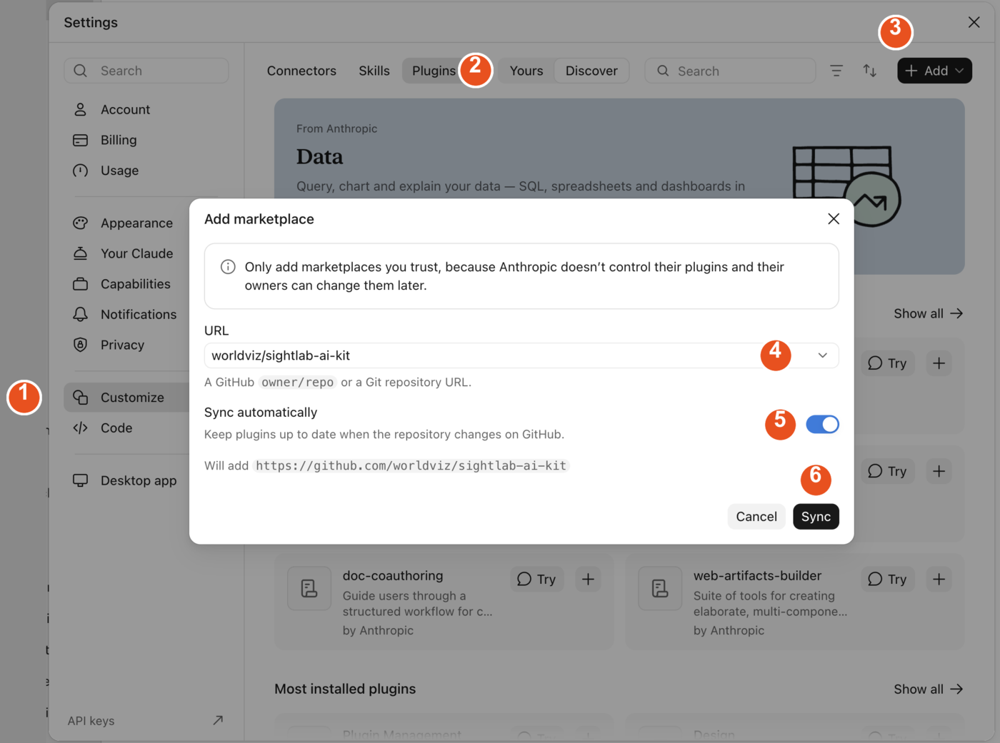
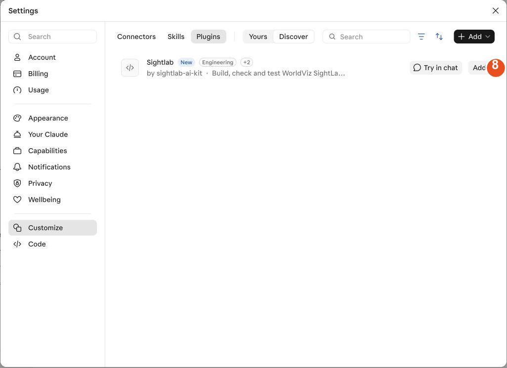

# Installing the SightLab AI Kit

> **Preview.** The Claude version, installed from GitHub as described below, is a preview until
> WorldViz announces its general release. The ChatGPT and Codex version is the reviewed release
> in OpenAI's plugin directory.

The SightLab AI Kit teaches your AI assistant how SightLab works, so it can answer SightLab
questions, write and fix SightLab scripts, and, on a PC with SightLab and Vizard installed,
check and run your experiment for you. You install it once in the AI app you already use. It
works in **ChatGPT and Codex**, where it is called **SightLab VR Assistant**, and in **Claude**;
pick the one you have. Both are free from WorldViz, but each needs a paid plan from its maker:

| App | Plan | Download |
|---|---|---|
| Claude desktop app (Mac or Windows) | Claude Pro or higher | [claude.ai/download](https://claude.ai/download) |
| Codex app (Mac or Windows) | ChatGPT Plus or higher | [developers.openai.com/codex/app](https://developers.openai.com/codex/app) |

On the Windows PC that has SightLab 2 and Vizard 8, the kit can also run its checks and launch
your experiment. On any other computer it still answers questions and writes scripts.

## ChatGPT and Codex

The kit is in OpenAI's plugin directory as **SightLab VR Assistant**, published by WorldViz.

1. Open the **Plugins** page: in ChatGPT, go to [chatgpt.com/plugins](https://chatgpt.com/plugins);
   in the Codex app, click the **Plugins** icon in the left rail.
2. Search for `SightLab VR Assistant`.
3. Open **SightLab VR Assistant** (WorldViz, "Build SightLab 2 experiments") and install it.
   The direct link is
   [chatgpt.com/plugins/plugins_6abfde9851388191aa6d87959f4703c4](https://chatgpt.com/plugins/plugins_6abfde9851388191aa6d87959f4703c4).
4. Start a new chat or thread. Plugins load when a thread starts, so an open thread will not see it.

To check and run experiments, use the Codex app on the SightLab PC; it is a separate download
from ChatGPT. The Codex tab inside the ChatGPT desktop app and the Codex command line share the
Codex app's installation, so one install covers all three.

## Claude

Installing here also installs it in Claude Code (Anthropic's terminal and VS Code tool) when
you sign in there with the same account; Claude Code picks it up the next time it starts.

1. Open Claude and click your name or initials in the lower-left corner, then **Settings**.
2. Click **Customize** in the left column.
3. Click the **Plugins** tab at the top.
4. Click **+ Add** in the upper right and choose **Add marketplace**.
5. Choose **Add from a repository** and enter `worldviz/sightlab-ai-kit` in the URL field.
6. Leave **Sync automatically** on, so updates reach you without any further steps.
7. Click **Sync**.
8. The Plugins page now shows **Sightlab** from sightlab-ai-kit. Click **Add**. A notice says
   "Sightlab is installed and ready to use".
9. Start a new chat.

If a notice asks you to grant the Claude GitHub App access so the marketplace can sync
automatically, click **Grant access** and approve it. That is what lets updates reach you
without any further steps.





## Using the kit

Start a new chat or thread after installing, then just ask. The kit wakes up whenever
SightLab comes up, and you can call it directly:

- **ChatGPT and Codex:** type `@` in the message box and pick **SightLab VR Assistant**.
- **Claude chat:** type `/` in the message box and pick **SightLab**, or click **+**.
- **Claude Code:** type `/sightlab:new` to start an experiment, `/sightlab:check` to check a script.

Good first messages:

- "Which SightLab version do I have, and what does `sightlab.SightLab()` take?"
- "Here is my script. The ratings never save; why?" and paste the script.
- "Build me a study: 12 images, 5 seconds each, rate each one 1 to 7, record gaze on each image."
- Paste a paper's methods section and ask for a SightLab version of it.

To let the kit check and run your experiment, open Codex or Claude Code in the folder that
holds your experiment on the SightLab PC (the Dashboard's project button below does this for
you). The first time it wants to launch Vizard it tells you what the run will check and asks
once, unless you asked for the run yourself. It only writes inside a `.autopilot` folder next
to your script and keeps the last five runs there; you can delete that folder at any time. Put
an empty file named `NO_AUTOPILOT` in a project folder to stop it from ever launching there.

Not sure the kit is loaded? Ask: *"Which SightLab skill do you have loaded, and what is its
version line?"* The answer names `sightlab-2` and a date-based version such as 2026.11.4.

## From the SightLab Dashboard

The SightLab Dashboard can open the assistant for you. Nothing is sent until you send it.

- **SightLab Assistant**, in the upper right, opens the assistant in your browser, the
  ChatGPT / Codex desktop app or Claude Desktop. Click the arrow to choose; the button
  remembers your choice. The same menu links to the Codex and Claude downloads.
- **SightLab Assistant ▾**, in a project's actions, opens a desktop app on that project's
  folder:
  - **ChatGPT / Codex Desktop** starts a new Codex thread in the folder, with
    `@SightLab VR Assistant` and the folder path already in the message box. Add your request
    and send it.
  - **Claude Desktop** copies a `/sightlab:new` prompt with the folder path and opens Claude
    Desktop on the folder (or tells you which folder to choose in its **Code** tab). Paste the
    prompt, add your request and send it. It also tells you if it could not find the SightLab
    plugin in Claude Code.

## Updates

- **ChatGPT and Codex:** new versions arrive through OpenAI's plugin directory once OpenAI has
  reviewed them.
- **Claude:** automatic, as long as **Sync automatically** stayed on.

## For command-line users

Claude Code can add the same marketplace from a terminal. Either route lands in the same place:
a plugin added in the desktop app is visible to the command line, and the other way round.

```
claude plugin marketplace add worldviz/sightlab-ai-kit
claude plugin install sightlab@worldviz
claude plugin update sightlab@worldviz        # later
```

One difference in direction: a plugin installed in the Claude desktop app or at claude.ai syncs
into Claude Code, but a plugin installed with the `claude` command stays in Claude Code and
does not appear in the chat app. If you use both, install from the desktop app.

The Codex command line uses the plugins installed in the Codex app, so install SightLab VR
Assistant there.

Questions or problems: write to your WorldViz contact, or open an issue at
[github.com/worldviz/sightlab-ai-kit](https://github.com/worldviz/sightlab-ai-kit/issues).
